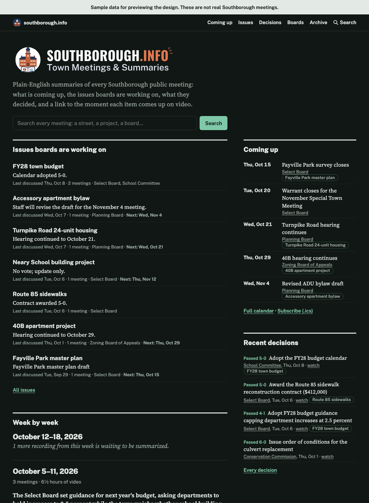
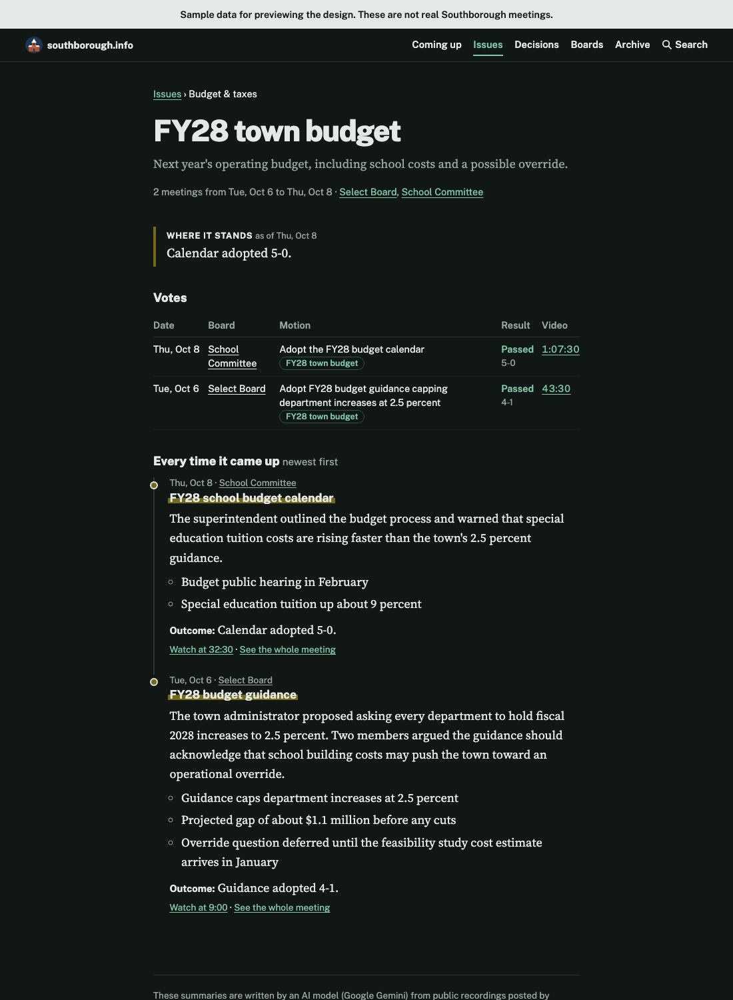
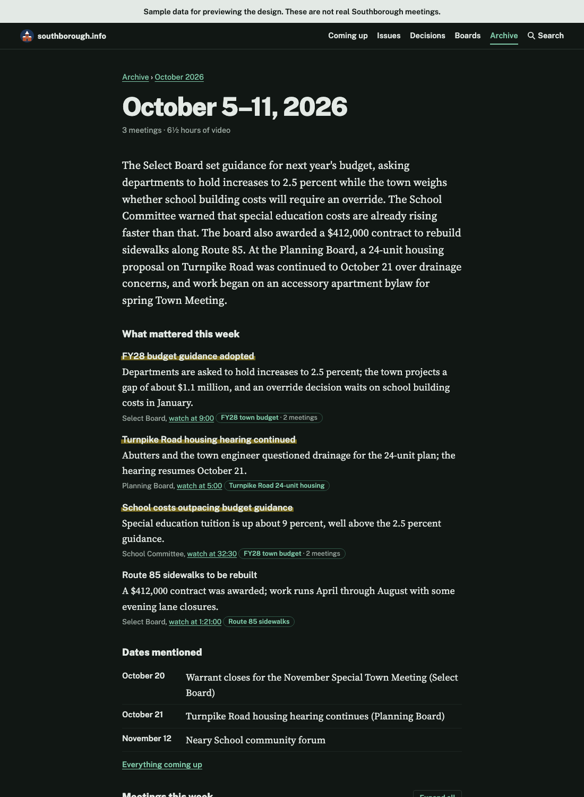

# Southborough This Week

A small, automated website that turns the town's [Southborough Remote Meetings](https://www.youtube.com/@southboroughremotemeetings5825/videos) YouTube recordings into plain-English summaries, organized so residents can find what's happening across hundreds of hours of meetings. The channel is set in `config.toml`.

- **Home** shows what's happening now: the next Town Meeting or election, the dates coming up in the next three weeks, the issues boards are actively working on, recent decisions, and a short take on each recent week.
- **Issues** follow one matter (a project, a property, a budget, a warrant article) across every board and week it comes up, with where it stands now, what's next, the votes, and a timeline linking to each moment on video.
- **Coming up** collects every hearing, deadline and meeting date mentioned in any meeting, and publishes it as a calendar people can subscribe to (`calendar.ics`).
- **Decisions** lists every vote, and you can filter it by board, result, topic or text.
- **Boards** gives each board or committee a page with its meetings, issues, votes and next date.
- **Weeks** cover every meeting in full: what was discussed, key numbers, outcomes, votes, public comment and dates, with a link to the exact moment in the video for every item. **Months** have a roll-up for people who check in occasionally.
- **Search** covers every meeting, issue and month (built with [Pagefind](https://pagefind.app), no server).
- **Feeds** are available for the site as a whole, for each issue and for each board.
- Runs on a daily schedule in GitHub Actions and publishes to GitHub Pages. No server to maintain.

| Home | An issue | A week |
| --- | --- | --- |
|  |  |  |

*Screenshots use fictional sample data.*

## How it works

Once a day, a GitHub Action:

1. **Finds new videos** on the channel, using the YouTube Data API (or the channel's RSS feed if you skip the API key). Titles that don't look like meetings (concerts, sports) are skipped.
2. **Summarizes each meeting** by passing its YouTube link to Gemini 3.8 Flash, which listens to the recording and looks at a frame every few seconds. No transcript scraping, which YouTube blocks from cloud servers. If 3.8 Flash is busy or over its free-tier limit, Gemini 3.5 Flash-Lite takes over.
3. **Writes a synopsis for each week** from that week's meeting summaries (a cheap, text-only call). A week is only rewritten when its meetings change.
4. **Links each week to issues** with another text-only call, oldest week first. The call tags each topic with the ongoing issue it belongs to (reusing an existing issue whenever the same matter comes up again, at any board), sorts it into a finer category, turns each date mentioned ("October 21", "next Tuesday's hearing") into a calendar date, and updates each issue's one-line status. No video is re-watched. Dates are checked in code: a date that can't be right for the meeting (for example a 2024 date mentioned at a 2026 meeting) is corrected or dropped.
5. **Writes a roll-up for each month** (text only).
6. **Commits the results** to `data/` in the repo. This is the pipeline's memory: each video is processed once.
7. **Builds and publishes the site** to GitHub Pages, with a search index, a calendar file and Atom feeds.

The first run looks back 28 days. Backfilling those weeks takes a few daily runs because of the daily budget below.

## Cost and safeguards

The default setup costs nothing and needs no credit card.

- **Gemini free tier.** Gemini 3.8 Flash is free of charge on the free tier, which allows up to 8 hours of YouTube video per day. The pipeline budgets 7 hours (420 minutes) per day by default and keeps a ledger in `data/state.json`, so even manual extra runs can't go over.
- **Per-run caps.** At most 6 videos per run, a 60-minute run limit, and a 20-minute timeout on each Gemini call. The text-only calls (weeks, issue links, months) are capped per run too, and each one only reruns when its meetings change.
- **No retry loops.** A video that fails twice is marked failed and left alone (re-run it with `requeue`, below). A per-minute rate limit gets one short wait and retry; a daily limit or a busy model moves on to the fallback model, and when none is left the run stops without counting against any video.
- **Long videos.** Anything over 5 hours is flagged instead of summarized.

If you later move to a paid Gemini tier, use prepaid credits and set a monthly **project spend cap** in Google AI Studio (Spend tab). Prepaid credits put a hard ceiling on what can be spent.

Note that on the free tier, Google may use the content you send to improve its products. These are public meeting recordings, so that is usually fine, but it's worth knowing.

## Setup (about 15 minutes)

1. **Create a public GitHub repository** and push these files to it. GitHub Pages is free for public repos.

2. **Get a Gemini API key.** In [Google AI Studio](https://aistudio.google.com/apikey), create an API key. Don't set up billing if you want to stay on the free tier.

3. **Get a YouTube Data API key** (recommended; free, no billing needed). Without it, the pipeline can only see the latest ~15 uploads and won't know video lengths, so budgeting is rougher and backfill is limited.
   - In the [Google Cloud console](https://console.cloud.google.com/), create a project.
   - Under *APIs & Services → Library*, enable **YouTube Data API v3**.
   - Under *Credentials*, create an **API key**, then restrict it to the YouTube Data API v3.
   - The pipeline uses a handful of quota units a day out of the default 10,000.

4. **Add the keys as repository secrets.** In the repo, go to *Settings → Secrets and variables → Actions → New repository secret*:
   - `GEMINI_API_KEY` (required)
   - `YOUTUBE_API_KEY` (recommended)

5. **Turn on GitHub Pages.** Go to *Settings → Pages* and set *Source* to **GitHub Actions**.

6. **Run it.** Open the *Actions* tab, choose **Meeting digest**, and click **Run workflow**. Tick *Dry run* the first time to see which videos it would summarize without calling Gemini. After that, it runs every morning on its own.

Your site will be at `https://<your-username>.github.io/<repo-name>/`. Put that URL in `site.base_url` in `config.toml` so the feed has absolute links.

## Catching up on older meetings

Issue pages get more useful the further back they go. To pull in older meetings, run the workflow by hand (*Actions → Meeting digest → Run workflow*) with **Days to look back** set to, say, `180`. Every older video is queued, and each daily run then works through the queue, newest first, within the daily budget.

On the free tier that budget is about 7 hours of video a day. To go faster, enable billing on the Gemini API key (set a spend cap in Google AI Studio first, as described above), then run the workflow with **Video minutes allowed today** set higher, for example `3000`, and **Max videos** set to `20`. Each run still stops after 60 minutes, so run it a few times in a row; the ledger in `data/state.json` keeps the total within the minutes you allowed. The cheap text-only steps (weeks, issue links, months) catch up automatically once the meetings are in.

## Tidying up issues

The links call reuses existing issues whenever it recognizes the same matter, but now and then it creates two issues for one thing. List them and merge the duplicate:

```bash
python -m digest issues                                    # every issue, most recently active first
python -m digest merge-issues peninsula-bridge peninsula-trail-bridge   # keep the second
git commit -am "Merge duplicate issue" && git push
```

## After the first run: tune the meeting filter

The run summary (click the run in the Actions tab) lists every video it **skipped** because the title didn't look like a meeting. If a real meeting was skipped, or a non-meeting got through, adjust `include_patterns` and `exclude_patterns` in `config.toml`. As a backstop, Gemini also flags videos that aren't public meetings, and those are hidden from the site.

## Configuration

Everything lives in `config.toml`:

| Setting | What it does |
| --- | --- |
| `extra_channels` | Other channels to pull from, limited to matching titles. Set up to take School Committee meetings from Southborough Access Media, which the remote-meetings channel doesn't carry. The same meeting found on two channels is only summarized once. |
| `discovery.backfill_days` | How far back to look for videos (default 28). |
| `discovery.min_age_hours` | Wait this long after upload before summarizing. |
| `budget.daily_video_minutes` | Daily video budget (default 420; the free tier allows 480). |
| `budget.max_videos_per_run` | Cap per run (default 6). |
| `gemini.model` | Model used for meetings (default `gemini-3.8-flash`). |
| `gemini.fallback_models` | Models to try when the main one is busy or over its limit (default `gemini-3.5-flash-lite`). |
| `gemini.video_processing` | `static` (default: audio plus a few frames) or `agentic`. |
| `gemini.redo_outdated_summaries` | When the prompts change, re-summarize meetings from the lookback window using spare daily budget (default on). |
| `gemini.thinking_level` | `low`, `medium` (default) or `high`. |
| `budget.max_link_weeks_per_run`, `budget.max_month_summaries_per_run` | Caps on the text-only issue-linking and monthly calls per run. |
| `site.title`, `site.description` | Site name and tagline. |
| `site.board_aliases` | Other spellings of a board's name, mapped to the name its page uses. |

The prompts, including the rubric for what counts as important and the list of categories, are in `digest/prompts.py`. The text-only calls have their own version numbers (`WEEK_PROMPT_VERSION`, `LINK_PROMPT_VERSION`, `MONTH_PROMPT_VERSION`): bump one and that step reruns over everything on the next run, without re-watching any video.

## Fixing a summary

When the prompts in `digest/prompts.py` change, bump `PROMPT_VERSION` and recent meetings are re-summarized automatically over the next few runs, after any new videos. Each old summary stays up until its replacement is ready.

To redo one specific summary on the next run:

```bash
python -m digest requeue VIDEO_ID
git commit -am "Requeue VIDEO_ID" && git push
```

`python -m digest status` lists every video the pipeline knows about and its status.

## Running locally

Requires Python 3.11 or newer.

```bash
pip install -r requirements.txt
python -m unittest discover -s tests          # tests use a fake Gemini, no keys needed
python scripts/build_sample_site.py           # build the site from fictional sample data
npx pagefind@1.3.0 --site _sample_site        # optional: build the search index
python -m http.server -d _sample_site         # then open http://localhost:8000

export GEMINI_API_KEY=... YOUTUBE_API_KEY=...
python -m digest run --dry-run                # see what would be summarized
python -m digest run --max-videos 1           # summarize one video
python -m digest build --out _site
```

## Things to know

- **Summaries can be wrong.** They're AI-generated; every item links to the moment in the video so readers can check. The site footer says this.
- **Timestamps are approximate.** They're usually within a minute of where an item starts.
- **Members of the public aren't named.** The prompt tells Gemini to describe public commenters generically and to name officials only when clearly identified.
- **Only public videos work.** Gemini can't read unlisted or private YouTube videos.
- **Preview features.** Gemini's YouTube URL input is relatively new. Agentic video mode failed on every YouTube link in testing, so the default is `static`.
- **Fonts are self-hosted** (Public Sans and Source Serif 4, SIL Open Font License), so visitors aren't tracked by a font service.
- **Scheduled workflows** in public repos pause after 60 days without repository activity. The data commits from new meetings keep it active; if it ever pauses, re-enable it from the Actions tab.

## Layout

```
config.toml                 settings
digest/                     the pipeline (standard library + Jinja2)
  youtube.py                find new uploads
  gemini.py                 Gemini Interactions API client (REST)
  prompts.py                prompts, JSON schemas, output cleaning
  pipeline.py               daily run: discover, budget, summarize, weeks, issue links, months
  site.py                   build the static site: home, weeks, months, issues, boards, decisions, calendar, search
templates/, static/         site templates, CSS, the filter script and fonts
data/                       the pipeline's memory (committed by the workflow)
  meetings/, weeks/, months/    summaries
  links/, issues.json           which topics belong to which issue, and each issue's status
.github/workflows/digest.yml
tests/                      unittest suite and fictional sample data
```
